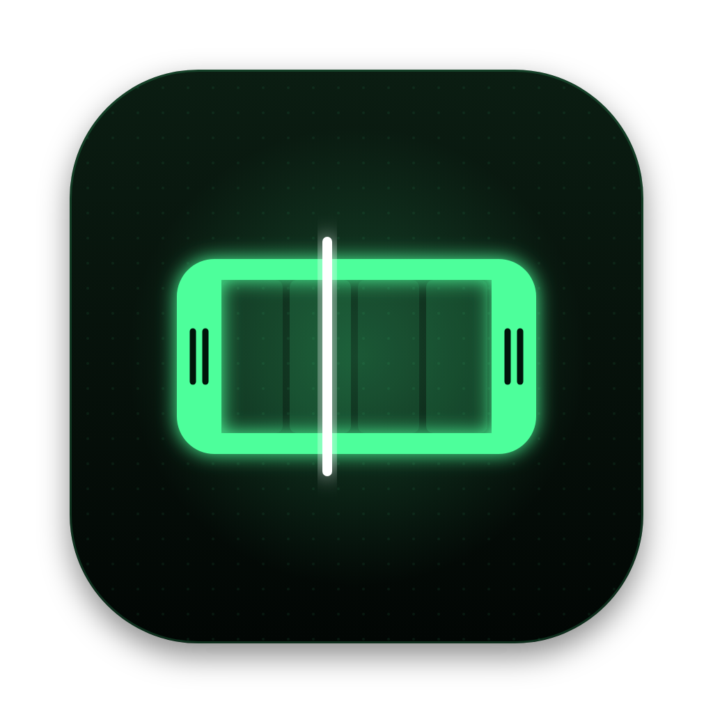
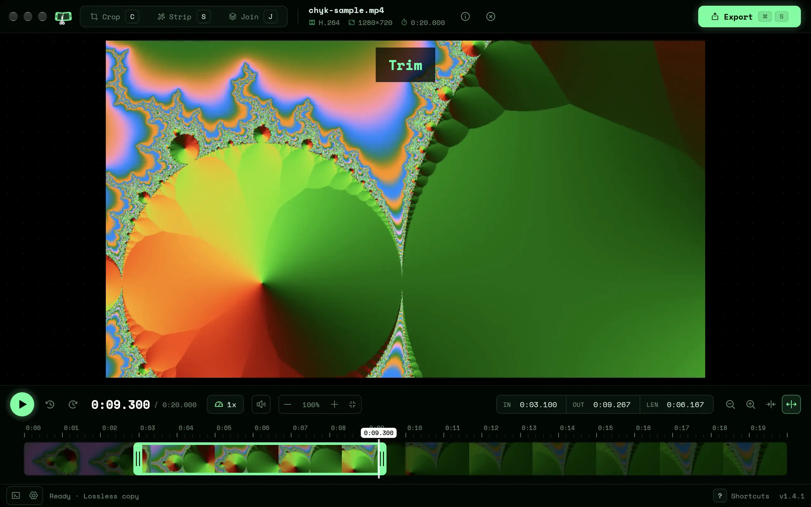

<p align="center"></p>

<h1 align="center">Chyk</h1>

<p align="center">
  A video editor for macOS, Windows and Linux: trim, crop, Strip and Join.<br>
  <a href="https://chyk.zgv2.dev">chyk.zgv2.dev</a> ·
  <a href="https://github.com/zgv2-dev/chyk/releases/latest">Download</a> ·
  <a href="CHANGELOG.md">Changelog</a>
</p>



Chyk opens a video, edits it and saves the result with as little re-encoding as possible. It is an editor, not a player: it adds itself to Open with, and never asks to be the default app for video files.

Interface in English and Ukrainian.

## Tools

- **Trim** — drag the handles on the filmstrip, press I and O, or type IN, OUT and LENGTH to the millisecond. A plain trim is a lossless stream copy.
- **Crop** — free or locked to 16:9, 9:16, 1:1, 4:3 or the original ratio. Output is rounded to even pixels.
- **Strip** — finds the stretches where nothing on screen changes and cuts them out, keeping some padding around each change. Ignore zones mask clocks, cursors and other areas from the scan.
- **Join** — puts several videos end to end on one timeline. Each clip keeps its own trim and fits the output frame with Fit, Fill, Stretch or Place. Clips that already match join losslessly; Chyk tries the seams first and offers a re-encode if a lossless join won't work. Strip works on a join clip by clip.
- **Speed** — 0.25× to 4×, with pitch-corrected audio, applied to both the preview and the export.

Also:

- **Export** to MP4, MOV or MKV at the original size or 4K down to 144p, with a size estimate for each. High, Medium, Low or Compress quality, hardware encoders first with a software fallback. The status bar says whether the export will be a lossless copy or a re-encode, and why.
- **Undo and redo** for trim, crop, Strip and speed.
- **Keyboard first** — every action has a key; press `?` for a searchable list.
- **Save this frame** as a PNG, at source resolution with the crop applied.
- **File info** — container, codecs, bitrate, frame rate, color and tracks.
- **ffmpeg log** — every command Chyk ran and its output, for when an export misbehaves.
- **Safe saving** — exports never overwrite the source, and a failed or cancelled export leaves the existing file alone. Temp files go in a hidden `.chyk-tmp` folder next to the video, readable only by you, and are removed when done.
- **Updates** — Chyk checks for new releases and downloads one only when you click Update.

The full feature list is in [features.md](features.md).

## Install

Builds for every platform are on the [releases page](https://github.com/zgv2-dev/chyk/releases/latest).

| Platform | File | Notes |
| --- | --- | --- |
| macOS, Apple silicon | [`Chyk-macos-arm64.dmg`](https://github.com/zgv2-dev/chyk/releases/latest/download/Chyk-macos-arm64.dmg) | Drag Chyk to Applications. |
| macOS, Intel | [`Chyk-macos-x86_64.dmg`](https://github.com/zgv2-dev/chyk/releases/latest/download/Chyk-macos-x86_64.dmg) | |
| Windows x64, installer | [`Chyk-windows-x64-setup.exe`](https://github.com/zgv2-dev/chyk/releases/latest/download/Chyk-windows-x64-setup.exe) | Installs for you or for all users. |
| Windows x64, portable | [`Chyk-windows-x64-portable.exe`](https://github.com/zgv2-dev/chyk/releases/latest/download/Chyk-windows-x64-portable.exe) | A single exe with libmpv and ffmpeg inside. No setup. |
| Linux, any distro | [`Chyk-linux-x86_64.AppImage`](https://github.com/zgv2-dev/chyk/releases/latest/download/Chyk-linux-x86_64.AppImage) | Portable, brings its own libmpv and ffmpeg. |
| Debian, Ubuntu | [`Chyk-linux-amd64.deb`](https://github.com/zgv2-dev/chyk/releases/latest/download/Chyk-linux-amd64.deb) | Uses the system libmpv and ffmpeg. Ubuntu 24.04 or later. |
| Fedora, openSUSE | [`Chyk-linux-x86_64.rpm`](https://github.com/zgv2-dev/chyk/releases/latest/download/Chyk-linux-x86_64.rpm) | Uses the system ffmpeg. |
| Arch | [`packaging/arch/PKGBUILD`](packaging/arch/PKGBUILD) | Repackages the .deb. Not on the AUR yet. |

Releases are not code-signed yet, so macOS Gatekeeper and Windows SmartScreen will warn on first launch.

### Windows

The installer offers two kinds of install:

- **Just for me** installs to your user folder and needs no admin rights.
- **All users** installs to Program Files after a UAC prompt and registers Chyk system-wide.

It downloads ffmpeg and mpv during setup and checks them against the hashes the release was built with. It adds Chyk to the Start menu, Installed apps and Open with for videos, and can add Edit with Chyk and a desktop shortcut. Running setup again offers Repair (Update, from an older version), Reinstall or Uninstall, with the option to keep your settings.

The portable exe needs no setup or internet. On first run it unpacks ffmpeg and mpv into a `Chyk` folder next to itself and keeps its settings there too.

### Linux

With the .rpm, export options that need an encoder your ffmpeg lacks (for example H.264 on Fedora's `ffmpeg-free`) are turned off, and a lossless copy is still available.

## Edit with Chyk

Settings → General has a switch that adds **Edit with Chyk** to the file manager's right-click menu for videos. It is per user and needs no admin rights.

- **Windows** — Explorer. On Windows 11 with Developer Mode on, the entry is also in the main menu, not only under Show more options.
- **Linux** — Dolphin, Nautilus, Nemo, Caja, PCManFM-Qt and Thunar, plus Open with for the AppImage.
- **macOS** — no switch needed: Chyk is in Finder's Open With and under Quick Actions.

On Windows and Linux the same can be done from a script:

```
chyk --register
chyk --unregister
```

## Settings

The gear in the status bar or <kbd>Ctrl</kbd>+<kbd>,</kbd> (<kbd>⌘</kbd>+<kbd>,</kbd> on macOS) opens the settings window. It covers language, Interface size (Auto, 100%, 125% or 150%), the right-click menu entry, update checks, export defaults, playback and Strip. Changes apply right away. Settings that also have a control in the editor, such as export options and Strip padding, are defaults for videos you open later and don't change an open one.

Settings are stored in `settings.toml`:

| OS | Location |
| --- | --- |
| Windows | `%APPDATA%\Chyk\settings.toml`, or `Chyk\settings.toml` next to the portable exe |
| macOS | `~/Library/Application Support/Chyk/settings.toml` |
| Linux | `$XDG_CONFIG_HOME/chyk/settings.toml` (usually `~/.config/chyk/`) |

## Build from source

Chyk is written in Rust (nightly, pinned in [`rust-toolchain.toml`](rust-toolchain.toml)) with [egui](https://github.com/emilk/egui). Playback uses libmpv, and editing and export use the ffmpeg command line.

Install [rustup](https://rustup.rs), then the platform's dependencies:

**Linux** (Ubuntu 24.04 or later; mpv 0.35 or later is required)

```sh
sudo apt-get install libmpv-dev ffmpeg libxkbcommon-dev
cargo run --release
```

**macOS**

```sh
brew install mpv
cargo run --release
```

**Windows** — run [`scripts/package-windows.ps1`](scripts/package-windows.ps1) from an x64 Native Tools prompt for Visual Studio 2022. It downloads libmpv and ffmpeg, builds, and writes `dist\Chyk-windows-x64-setup.exe` and `dist\Chyk-windows-x64-portable.exe` (the portable one is `cargo build --release --features portable`).

Tests: `cargo test` (the export tests need `ffmpeg` and `ffprobe` on `PATH`).

Packages are built by [`scripts/package-macos.sh`](scripts/package-macos.sh), [`scripts/package-linux.sh`](scripts/package-linux.sh) and [`scripts/package-windows.ps1`](scripts/package-windows.ps1), the same steps CI runs on every push. Tagging `v*` publishes a release with the matching [CHANGELOG.md](CHANGELOG.md) section as its notes.

Further reading:

- [SPEC.md](SPEC.md) — architecture, source layout and behavior in detail.
- [`assets/i18n/`](assets/i18n) — translations. `python3 scripts/i18n-editor.py` opens an editor with a live preview.
- [`design/concepts/`](design/concepts) — the UI mockups.

## License

[GPL-3.0-or-later](LICENSE). Bundled fonts are under the SIL Open Font License; see [`assets/fonts/`](assets/fonts).

[Report a problem](https://github.com/zgv2-dev/chyk/issues/new)
